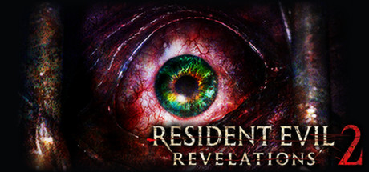

**Resident Evil Revelations 2 is an episodic survival horror featuring parallel campaigns: Claire Redfield and newcomer Moira Burton fighting a cult, while Barry Burton and mutant girl Natalia search a later timeline. Features a two-character puzzle cooperation system.**

---

## 📖 About

Resident Evil Revelations 2 is an episodic survival horror featuring parallel campaigns: Claire Redfield and newcomer Moira Burton fighting a cult, while Barry Burton and mutant girl Natalia search a later timeline. Features a two-character puzzle cooperation system.

## ⚠️ Problems Without Trainer

| Problem | Status |
|---------|--------|
| **Partner AI** — Computer-controlled partner characters make poor decisions in combat | ✅ Solved |
| **Resource Scarcity** — Ammunition and herbs strictly limited requiring careful consumption | ✅ Solved |
| **Invisible Enemies** — Revenant variant enemies require Moira's flashlight to make vulnerable | ✅ Solved |
| **Score Attack** — Getting top scores in raid mode requires extensive build optimization | ✅ Solved |

## ✅ Solution

The **Resident Evil Revelations 2 Trainer** solves all these issues by giving you complete control over the game.

## 🎯 Full Feature List

- Unlimited Resources
- God Mode / Invincibility
- Instant Skill Cooldown
- One-Hit Kill
- Freeze Game Timer
- Unlock All Items & Achievements
- Custom Speed Multiplier
- Save State Anywhere

## 🚀 Quick Start

1. **Disable Windows Defender** temporarily (trainer may trigger false positive)
2. Download the trainer from the button above
3. Launch Resident Evil Revelations 2
4. Run the trainer as Administrator
5. Activate desired cheats with hotkeys

## 💎 Free vs Paid

| Feature | Free | Pro |
|---------|------|-----|
| Basic God Mode | ✅ | ✅ |
| Unlimited Resources | ✅ | ✅ |
| All Advanced Cheats | ❌ | ✅ |
| Auto-Updates | ❌ | ✅ |
| Priority Support | ❌ | ✅ |

## 💻 Requirements

- Windows 10/11 (64-bit)
- Resident Evil Revelations 2 (any version)
- .NET Framework 4.8+
- DirectX 11+

## 🍎 macOS

macOS users can use our alternative tool:

## ⚖️ Legal

This trainer is for educational and single-player use only. Use responsibly.

---

